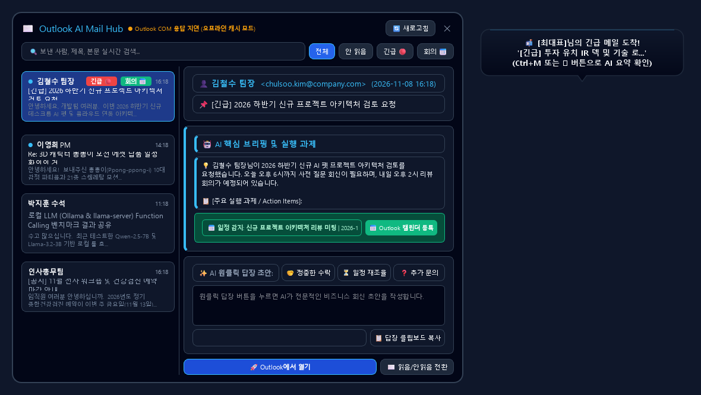

# 🦄 3D AI 데스크톱 미니펫 '뽕뽕이' (Ppong-ppong-i) v3.0

> **차세대 3D WebGL 실시간 물리 인터랙션 & 엔터프라이즈 업무 생산성 AI 데스크톱 컴패니언**



---

## 🌟 프로젝트 소개
**미니펫 뽕뽕이(Ppong-ppong-i)**는 Windows 바탕화면 위에서 자유롭게 뛰어노는 차세대 3D 인터랙티브 AI 데스크톱 비서입니다.  
초경량 PyQt6 프레임워크와 Three.js WebGL 실시간 3D 렌더링 엔진을 융합하여, 부드러운 물리 기반 애니메이션, 30여 종의 다채로운 RPG 혼자 놀기 액션, 엔터프라이즈 Outlook 메일 요약 및 답장 자동화, 화면 중앙 3D 비주얼 알람 시스템을 제공합니다.

---

## ✨ 핵심 주요 기능

### 1. 🎮 30종 RPG 혼자 놀기 시스템 (Solo Play Activities)
사용자가 직접 명령하거나, 자율적인 타이머에 따라 미니펫이 혼자서 생생한 소품과 함께 3D 놀이를 펼칩니다.
* **건축 & 제작**: 블록 옮기기 & 망치질로 아늑한 4단 집 짓기 (`build_house`)
* **캠핑 & 힐링**: 모닥불 피우고 마시멜로 노릇하게 구워 먹기 (`camping`), 해변 파도 서핑 (`surfing`)
* **아웃도어 & 탐험**: 낚싯대 던져 물고기 낚기 (`fishing`), 잠자리채 곤충 채집 (`hunting`), 쌍안경 탐험 (`explorer`), 보물상자 발굴 (`treasure`)
* **엔터테인먼트 & 예술**: 일렉 기타/우쿨렐레 연주 (`music_guitar`), 이젤 캔버스 그림 그리기 (`painting`), DJ 파티 비트 드롭 (`party_dj`)
* **일상 & 전문직**: 바리스타 핸드드립 커피 (`barista`), 마법서 독서 (`reading`), 천체 망원경 별자리 관측 (`telescope`), 타임머신 시공간 점프 (`timemachine`), 탐정 돋보기 수사 (`detective`), 닌자 은신 분신술 (`ninja`) 외 다수

### 2. ⚡ 3D RPG 다이내믹 모션 & 인터랙션 (Strict Mutex)
* **🗺️ 2D RPG 전 방향 자유 탐험 (`Ctrl+9`)**: 작업표시줄에 국한되지 않고 바탕화면 전체(상/하/좌/우/대각선)를 2D RPG 캐릭터처럼 순찰하며, 이동 벡터(`dx, dy`)에 맞춰 3D 캐릭터가 진행 방향으로 자연스럽게 몸을 회전합니다. (탐험 시간: **6초 ~ 25초 랜덤 연장**)
* **🏃 3-모드 마우스 회피 AI (`Ctrl+8`)**:
  1. *속도 기반 스마트 회피*: 마우스가 빠르게 휙 다가오면 깜짝 놀라 반대 방향으로 질주하고, 천천히 살며시 다가가면 쓰다듬기/클릭 허용
  2. *거리 기반 상시 회피*: 반경 180px 내 접근 시 자동 지그재그 대시 도망
  3. *도망 후 도발 리액션*: 안전 거리를 확보하면 멈춰서 메롱/점프하며 "잡아봐라~ 😜" 도발
* **✂️ 바탕화면 내용 캡처 & 들고 튀기 (Screen Content Heist 2.0 / `Ctrl+3`)**:
  - 실제 바탕화면 텍스트/아이콘을 `grabWindow`로 캡처하여 머리 위에 들고 2D 질주
  - 캡처된 원래 자리에는 **찢어진 구멍/지우개 착시 오버레이(`ScreenHoleOverlay`)**가 덮여 진짜로 뜯겨 나간 듯한 유쾌한 착시 연출
  - **3중 복원**: 10~15초 도망 후 원래 자리에 찰칵 붙여주며 자동 복원, 사용자가 마우스로 클릭/터치 시 "들켰다! 💖" 즉시 복원, 25초 타임아웃
* **🚀 슈퍼맨 장거리 에어로다이내믹 활공 비행 (`Ctrl+5`)**:
  - 비행 지속 시간이 **8초 ~ 25초 랜덤**으로 연장되어 화면 전체를 가로지르는 대규모 다중 곡선 선회 비행
* **🕸️ 스파이더맨 거미줄 비행 (`Ctrl+1`)**: 바탕화면 벽과 천장을 잇는 2~5단 연속 아크로바틱 스윙
* **🙈 빼꼼 숨바꼭질 (`Ctrl+2`)**: 창문/작업표시줄 뒤로 숨어 빼꼼 스캔하다가 마우스가 오면 "까꿍!"
* **🎨 대형 마법 네온 낙서 (`Ctrl+4`)**: 화면 중앙에 100% 완전 밀폐형 네온 하트/별 궤적 드로잉

### 3. 📬 Executive Outlook AI 스마트 메일 허브
* **디자인 & 편의성**: Microsoft 365 / Superhuman 스타일의 모던 글래스모피즘 HUD
* **스마트 아바타**: 발신자 이름 기반 컬러 해시 모노그램 아바타 자동 생성
* **세그먼트 필터**: 전체 / 안 읽음 / 긴급(🔴) / 회의(📅) 실시간 필터링
* **듀얼 뷰 탭**:
  1. `[⚡ AI 스마트 브리핑]`: 핵심 요약, 액션 체크리스트, 원클릭 아웃룩 캘린더 일정 등록, 3-Tone AI 답장 초안(정중형, 간결형, 수락/확인형) 자동 작성
  2. `[📄 이메일 원문 보기]`: 서식 유지 HTML/텍스트 원문 열람
* **실시간 상호 운용**: 원클릭으로 아웃룩 원본 메일 클라이언트 직접 실행

### 4. ⏰ 3D 입체 비주얼 알람 & 타이머 매니저
* **자연어 알람 등록**: 채팅창에 *"내일 오전 9시 주간 회의 알람 맞춰줘"*라고 말하면 시간/제목 자동 추출 등록
* **화면 중앙 3D 비주얼 팝업**: 시간이 도래하면 화면 정중앙에 화려한 회전 3D 모래시계 팝업이 고정 표시
* **다중 알람 매니저 UI**: 등록된 모든 알람을 한눈에 조회, 토글(활성/비활성), 편집 및 삭제

### 5. 💬 독립 플로팅 AI 채팅 & 프롬프트 히스토리
* **Zero Occlusion**: 3D 캐릭터 캔버스 뒤에 가려지지 않는 완전 독립 탑레벨 플로팅 윈도우
* **히스토리 타임라인**: 과거 대화 기록을 타임라인으로 조회하고, **'이어서 작업 ↵'** 버튼으로 이전 프롬프트 원클릭 재사용
* **PC 최적화**: 임시 파일 정리 및 메모리 가비지 컬렉션을 즉시 실행하는 원클릭 클린업 버튼 내장

---

## ⌨️ 단축키 안내

| 단축키 | 기능 설명 |
| :--- | :--- |
| **Ctrl + M** | Executive Outlook AI 메일 허브 열기 / 닫기 |
| **Ctrl + 1** | 스파이더맨 연속 거미줄 비행 |
| **Ctrl + 2** | 빼꼼 숨바꼭질 |
| **Ctrl + 3** | 화면 내용 캡처 & 훔쳐 달아나기 (Heist 2.0) |
| **Ctrl + 4** | 마법 무지개 네온 낙서 |
| **Ctrl + 5** | 슈퍼맨 장거리 다중 곡선 비행 (8~25초) |
| **Ctrl + 8** | 3-모드 마우스 회피 AI 트리거 |
| **Ctrl + 9** | 전방위 2D RPG 자유 탐험 (6~25초) |
| **Ctrl + =** / **Ctrl + +** | 미니펫 크기 확대 (+10%) |
| **Ctrl + -** | 미니펫 크기 축소 (-10%) |
| **Ctrl + 0** | 미니펫 크기 기본 배율(100%)로 리셋 |
| **Ctrl + Q** | 미니펫 애플리케이션 안전 종료 |
| **마우스 더블클릭 / 우클릭** | 인사 모션(Wave/Jump) 및 AI 채팅창 토글 |
| **마우스 드래그 & 드롭** | 공중에서 매달리기 & 중력 가속도 낙하 후 바운스 착지 |
| **마우스 쓰다듬기** | 볼 붉히기, 기분 좋은 표정 및 귀 쫑긋 리액션 |

---

## 🚀 설치 및 실행 방법

### 1. 사전 요구사항
* Windows 10 / 11
* Python 3.10 이상

### 2. 원클릭 실행 (권장)
루트 경로의 `run_ppong.bat`을 더블 클릭하면 가상환경 구성 및 패키지 설치 후 백그라운드로 안전하게 실행됩니다.
```cmd
run_ppong.bat
```

### 3. 수동 실행
```bash
# 1. 가상환경 생성 및 활성화
python -m venv .venv
.venv\Scripts\activate

# 2. 필수 라이브러리 설치
pip install -r requirements.txt

# 3. 미니펫 실행
python main.py
# (콘솔 창 없이 백그라운드로 실행할 경우)
pythonw main.py
```

---

## 📁 프로젝트 구조

```
11.Minipet/
├── assets/                  # 3D 에셋 및 리소스
├── alarm_3d.html            # Three.js 3D 모래시계 렌더링 페이지
├── alarm_dialog.py          # 화면 중앙 3D 입체 비주얼 알람 팝업 다이얼로그
├── alarm_manager_dialog.py  # 알람 목록 조회 / 편집 / 삭제 관리 UI
├── alarm_service.py         # 자연어 알람 파서 및 백그라운드 타이머 엔진
├── chat_window.py           # 무가림 독립 탑레벨 AI 채팅 & 히스토리 타임라인 창
├── index.html               # Three.js 3D 캐릭터 렌더러 및 스페셜 액션 셰이더
├── main.py                  # PyQt6 메인 윈도우, 물리 엔진, 액션 뮤텍스 관리자
├── outlook_hud.py           # Superhuman 스타일 AI 메일 브리핑 & 캘린더 허브
├── outlook_service.py       # Outlook COM 연동 및 메일 AI 분석 서비스
├── run_ppong.bat            # 원클릭 백그라운드 실행 배치 스크립트
├── solo_play.js             # 30종 RPG 솔로 플레이 시스템 & 소품 3D 지오메트리
├── system_cleaner.py        # PC 쾌적화 & 메모리 정리 엔진
└── requirements.txt         # 파이썬 의존성 목록
```

---

## 🛡️ 라이선스
MIT License

